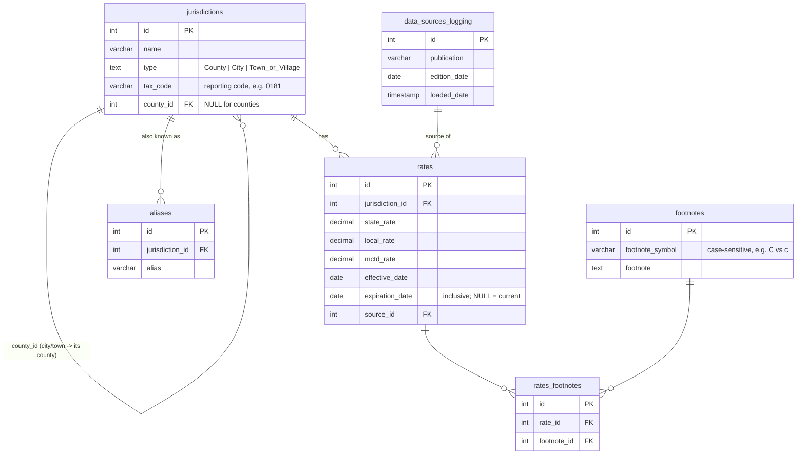

# NYS Sales Tax Lookup

A Java console application that looks up the New York State combined sales tax rate for a jurisdiction on a given date and calculates the tax owed.

Enter a county, city, town or village, a purchase amount and a transaction date (today by default), and it returns the combined state + local rate, the tax, the total, and the date that rate took effect. Rates are stored with effective dates, so the app answers "what was owed on that date?" as well as "what is the rate today?"

Rates come from the NYS Department of Taxation and Finance publications **Pub 718** (current combined rates) and **Pub 718-A** (enactment and effective dates of past rates).

## Tech stack

- **Java 21** (built with `--release 21`), **Maven**
- **Plain JDBC** with DAO classes: no Spring, no ORM, to show the fundamentals directly
- **PostgreSQL** (SQL kept close to standard so it ports to DB2)
- **JUnit 5**: 25 tests

## Project layout

```
pom.xml
db.properties.example        copy to db.properties (git-ignored) and fill in
src/main/java/com/jakeladd/salestax/
    App.java                 console menu: input, "did you mean", result display
    ConnectionFactory.java   reads db.properties, hands out JDBC connections
    Jurisdiction.java        record: one jurisdiction row
    JurisdictionDao.java     name search (case-insensitive), includes county name
    Rate.java                record: one rate row
    RateDao.java             as-of-date rate lookup
    FootnoteDao.java         footnotes attached to a rate
    DataSourceDao.java       latest edition of each publication (shown in the banner)
    TaxCalculator.java       routing rules + tax math (no SQL, no console I/O)
    TaxResult.java           record: the calculated answer, with footnotes
    LoadPlanner.java         reads data/*.csv and works out every row to insert (no SQL)
    LoadPlan.java            records describing those rows
    DataLoader.java          inserts the plan in one transaction
src/test/java/com/jakeladd/salestax/
    TaxCalculatorTest.java   math tests (no database)
    RateLookupTest.java      lookup and routing tests (needs the full data load)
SQL/
    rebuild_all.sql          one-step rebuild: schema, app role, tables, small seed data
    drop_script.sql, seed_test_data.sql, table_creation/, queries/
data/
    pub718_rates.csv, pub718_aliases.csv, pub718a_history.csv, pub718a_footnotes.csv
```

The layers are kept separate on purpose: `App` handles the user, `TaxCalculator` holds the tax rules, and the DAOs hold all the SQL. A servlet/JSP front end could replace `App` without changing anything else.

## Database schema



All tables live in the `sales_tax` schema.

**Build order:** jurisdictions, footnotes, data_sources_logging, rates, rates_footnotes, aliases
**Drop order:** aliases, rates_footnotes, rates, footnotes, jurisdictions, data_sources_logging

## Design decisions

- **A rate change is a new row, never an update.** Each rate has an `effective_date` and an `expiration_date`, so history is preserved and a new rate can be loaded as soon as it is published; the lookup switches to it on its effective date with no code change.
- **Expiration dates are inclusive, and NULL means "still current."** The as-of query is `effective_date <= ? AND (expiration_date IS NULL OR ? <= expiration_date)`. Because the columns are `DATE` with no time part, "through Feb 28" is unambiguous. The loader sets each expiration to the next rate's start date minus one day (`LocalDate.minusDays(1)`, which handles leap years).
- **One rate period per jurisdiction per start date**, enforced by `UNIQUE (jurisdiction_id, effective_date)`.
- **Rates are split into state, local and MCTD components.** Both the 4% state rate and the Metropolitan Commuter Transportation District surcharge have changed over time (4¼% state rate 2003–2005; MCTD ¼% then ⅜%), so they are stored per period rather than hardcoded.
- **Money is `BigDecimal` throughout, rounded once.** Tax is `amount × rate ÷ 100`, rounded half-up directly to cents. Rounding in two steps (to 4 places, then to 2) gives the wrong answer in edge cases: $1.47 at 8.5% is 0.12495, which must round to $0.12, not $0.13. There is a test for this.
- **Rates are never rounded**, only the final tax, so three-decimal rates like 8.875% stay exact.
- **Routing by jurisdiction type** (in `TaxCalculator`):
  - towns and villages use their county's rate;
  - cities use their own rate if they have one on that date, otherwise their county's, and the result says so;
  - counties use their own rate.
- **Name collisions are expected.** "Oneida" is both a county and a city, and the City of Oneida is in *Madison* County. The search returns every match and the user picks from a "did you mean" list showing type and county. Jurisdiction uniqueness is `(name, type, county_id)`.
- **Footnotes are many-to-many**, through the `rates_footnotes` junction table, because a single 718-A line can carry several footnotes (e.g. `c/d/e/q`). Footnotes are shown with the result, not interpreted.
- **The banner shows the data's edition**, read from `data_sources_logging`, so users know how current the rates are.
- **SQL injection is prevented** by using `PreparedStatement` with bound parameters everywhere.
- **Portable SQL for DB2:** `LOWER(name) = LOWER(?)` instead of Postgres's `ILIKE`; standard joins and constraints. Postgres-specific choices are noted (`SERIAL`, `NULLS NOT DISTINCT`).
- **Least privilege:** the app connects as `salestax_app`, which can read and write rows in `sales_tax` but cannot create, alter or drop tables. Schema changes run as `postgres`.
- **Loading is split into planning and inserting.** `LoadPlanner` turns the CSVs into rows with no database access, so bad data fails before anything changes. `DataLoader` then inserts everything on one connection in **one transaction**: it deletes the old rows, inserts in dependency order, and commits only at the end; any error rolls back to the previous data. It uses `DELETE` rather than `TRUNCATE`, because `TRUNCATE` needs extra privileges and cannot be rolled back in DB2.
- **Rows refer to each other by natural key until inserted.** Generated ids are captured with `getGeneratedKeys()` and kept in maps (e.g. `JurisdictionKey → id`), so cities can point at their county and rates at their jurisdiction.
- **Credentials stay out of source control:** `db.properties` is git-ignored; `db.properties.example` shows the format.

## Setup

Requirements: JDK 21 or newer, Maven 3.9+, PostgreSQL 15+ (for `NULLS NOT DISTINCT`).

1. **Create the database.** In pgAdmin or psql, connected to the default `postgres` database:
   ```sql
   CREATE DATABASE nys_tax;
   ```
2. **Set the app role's password.** In `SQL/rebuild_all.sql`, replace `CHANGE_ME` with a password of your choice (don't commit it).
3. **Build the schema.** Open a Query Tool on `nys_tax` as `postgres` and run `SQL/rebuild_all.sql`. It is safe to re-run; it drops and recreates everything.
4. **Configure the connection.** Copy `db.properties.example` to `db.properties` in the project root and fill in the `salestax_app` password.
5. **Load the data:** run `com.jakeladd.salestax.DataLoader` from your IDE, or from the project root:
   ```
   mvn compile exec:java -Dexec.mainClass=com.jakeladd.salestax.DataLoader
   ```
   It replaces all rows in one transaction and is safe to re-run. Expected counts: 2 sources, 34 footnotes, 93 jurisdictions, 510 rates, 176 rate-footnote links, 8 aliases.
6. **Run the tests:**
   ```
   mvn test
   ```
7. **Run the app:** run `com.jakeladd.salestax.App` from your IDE, or:
   ```
   mvn compile exec:java -Dexec.mainClass=com.jakeladd.salestax.App
   ```

Programs must be started from the project root so they can find `db.properties` and `data/`.

## Example

```
Enter a county, city, town or village (or Q to quit)
oneida
#    Name                 Type             County
--   ----                 ----             ------
1    Oneida               County
2    Oneida               City             Madison
Choose a number between 1 and 2:
1
Transaction amount: $100
Transaction Date (YYYY-MM-DD, Enter for today): 2007-12-01

----------------------------------------------
  Jurisdiction:     Oneida (County)
  Date:             2007-12-01
  Combined rate:    8.75%
  Rate effective:   2007-12-01
  Purchase:         $100.00
  Tax:              $8.75
  Total:            $108.75

  Note: County rate applies.
  Footnotes:
    C: Additional rate will expire effective 30 Nov. 2027.
----------------------------------------------
```

## Tests

`mvn test` runs 25 tests.

- **`TaxCalculatorTest`** (no database, 6 tests): rounding up at half a cent, the $1.47 × 8.5% double-rounding case, three-decimal rates, a one-cent purchase, and the combined-rate sum.
- **`RateLookupTest`** (requires the full data load, 19 tests):
  - search: unknown names, case-insensitive matching, the Oneida and Fulton county/city collisions;
  - history: Oneida County's rate change on 2007-12-01 (day before, day of, today), state-only tax before the county tax began, the 4¼% state rate in 2003–2005, and no rate before sales tax existed (1965);
  - current rates: New York City and Yonkers (8.875%, including MCTD) match Pub 718;
  - routing: a city with its own rate, a city that repealed its tax (Elmira → Chemung County), a town using its county's rate, and an unknown jurisdiction type;
  - footnotes: rates carrying two footnotes (Schenectady County: C and E; Utica: a and *).

## Data

All 57 counties and New York City have rate history back to the start of the sales tax in 1965; 36 cities are loaded, 19 with current rates and 17 that have repealed their tax (lookups for those fall back to the county).

How the history is built:
- **Counties:** Pub 718-A gives each county's local rate and its effective dates. Each period is split wherever the state rate or the MCTD surcharge changed, so every row carries the state, local and MCTD rates in force at that time. Before a county's first local tax, a 0% local row means the state rate still applies.
- **Cities:** the current combined rate from Pub 718. The city's local share (combined − state − MCTD, using today's state and MCTD rates) is dated from the later of the city's and its county's last change in 718-A, and split at state/MCTD changes after that.
- Every county's and city's current rate was checked against Pub 718.

The `data/` folder holds the source publications as CSV:

- `pub718_rates.csv`: Pub 718 (edition effective March 1, 2025): combined rates, reporting codes, MCTD flags. Used for reporting codes and to cross-check history.
- `pub718a_history.csv`: Pub 718-A (Dec 2025 revision): local rates with their real effective dates, including repeals and expirations.
- `pub718a_footnotes.csv`: all 718-A footnotes.
- `pub718_aliases.csv`: borough names that map to New York City.

## Current limitations and next steps

- **City history is approximate before each city's most recent change.** Older dates fall back to the county rate; exact historical city rates depend on how each 718-A footnote splits the tax between city and county.
- **No town/village list yet.** The search and routing support towns and villages, but the data still needs to be sourced and loaded.
- **Aliases are stored but not yet searched** (e.g. "Brooklyn" → New York City).
- **The "except cities" warning** (picking a county whose cities have their own rate) is designed but not yet built.
- **Villages that span two counties** are not modeled; the lookup would need the address to decide.
- **Inserts are row by row** (about 630 statements). Fine at this size; JDBC batching would be the next step for a large load.
- **One connection per lookup.** Fine for a console app; a connection pool (e.g. HikariCP) would be the next step for a server.
- **Stretch goal:** a servlet/JSP page on Tomcat calling the same `TaxCalculator`.

## How this was built

I wrote the application code, SQL schema and queries myself, using an AI assistant as a tutor for design review, explanations and code review. The CSV transcriptions of the Tax Department publications, the rebuild script, the load planner (`LoadPlanner`/`LoadPlan`), the test suite and this README were drafted with AI assistance and reviewed by me; I wrote the `DataLoader` that inserts the plan.
